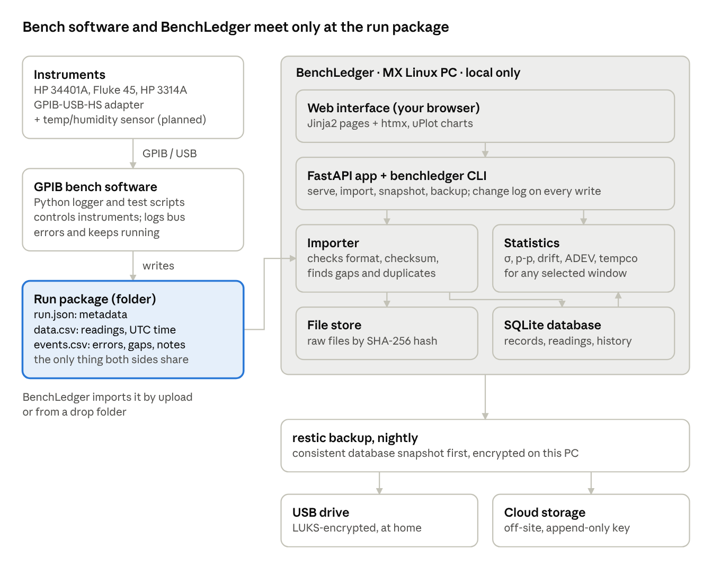
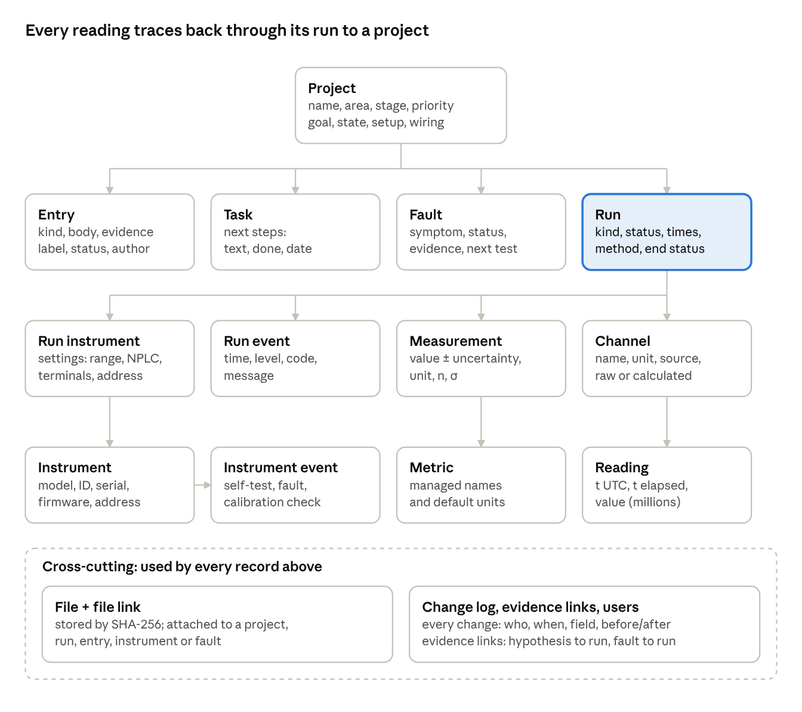

# BenchLedger — Design v0.1

Signed off Nov 7, 2026 · twodogstar

## Summary

BenchLedger (formerly BenchWorks) is a Python web app on the MX Linux PC. It has a server-rendered interface, an SQLite database and a folder of raw files that are never changed after they're stored. It implements [Requirements v1.0](requirements.md), signed off Nov 7, 2026. This design was signed off the same day; changes from here go through a new version.

**Key decisions**

- **Separate from the bench software.** The GPIB bench software writes *run packages*; BenchLedger imports them. Neither depends on the other being up.
- **Stack A:** FastAPI, Jinja2 templates, htmx, SQLite through SQLAlchemy with Alembic migrations, numpy for statistics, and uPlot for charts. Mostly Python, no front-end build step.
- **A change log for everything.** Every change to any record is written to an add-only change log in the same database transaction, which gives M2's edit history across the whole app.
- **Content-addressed files.** Raw files are stored under their SHA-256 hash, so they can't be silently changed and duplicates are caught automatically.
- **Readings in SQLite.** Readings live in an indexed table; charts thin them only for display.
- **A command-line tool.** One `benchledger` command handles serve, import, snapshot and backup, and backs the one-command start in N1.
- **Public repo from day one.** Data, keys and passwords are never committed. The owner reviews code and commits it; Claude writes it.

## Architecture

Two independent programs meet at one file format. The GPIB bench software writes a run package, and BenchLedger imports it, stores the raw files unchanged, and serves everything to your browser from the same PC.



The bench software never calls BenchLedger, so an overnight run keeps logging even if the app is down. Backups take a consistent database snapshot, then copy the database and file store nightly to an encrypted USB drive and an off-site cloud bucket.

## Tech stack (ADR-0001)

Decision: Stack A, mostly Python with a server-rendered interface. It keeps the code under review in one main language, shares that language with the GPIB logger, runs light on the Phenom II, and builds skills that matter for test, automation and R&D roles. Status: accepted Nov 7, 2026. Full record: [ADR-0001](adr/0001-tech-stack.md).

| Layer | Choice | Why | Considered instead |
| --- | --- | --- | --- |
| Language | Python 3.11 (MX ships 3.11.2; git 2.39.5), in a virtual environment | Same language as the bench software | — |
| Web framework | FastAPI + Uvicorn | Type-checked request handling, automatic API docs (ready for C5) | Flask |
| Pages | Jinja2 templates + htmx | Pages update in place without a JavaScript app or build step | React |
| Charts | uPlot | Small and fast; handles millions of time-series points | Chart.js, Plotly |
| Database | SQLite (WAL mode) via SQLAlchemy 2.0 | One file, no server, readable without the app (N4) | PostgreSQL (later, if multi-user cloud) |
| Migrations | Alembic | Versioned schema changes, never silent resets (N6) | — |
| Statistics | numpy; Allan deviation written in-house and checked against the `allantools` library in tests | Fast, standard; the in-house version is easy to audit | pandas |
| Markdown | markdown-it-py + nh3 cleanup | Safe rendering of entry text (N9) | — |
| Command line | Typer | `benchledger serve / import / snapshot / backup` | argparse |
| Tests and quality | pytest, ruff (lint and format), GitHub Actions | Tests and lint run on every push (N10) | — |
| Packaging | pyproject.toml with uv | Fast installs, lock file for repeatable setups; plain pip also works | pip-tools, Poetry |
| Backups | restic, run by systemd timers | Encrypted, stores only changes, works with USB and S3-compatible cloud storage (B1) | BorgBackup |
| Running it | systemd user service, bound to 127.0.0.1 | Starts on login, restarts on failure, local-only by default (N1) | Docker (later, for self-hosting) |

## Data model

The model has three parts: the notebook (projects and what is known about them), runs with their data, and equipment. They're tied together by files, a change log and evidence links that every record shares.



Arrows point from a parent to its many children: a project has many entries, tasks, faults and runs; a run has many channels, events, measurements and per-run instrument settings; a channel holds its readings. One instrument appears in many runs through its per-run settings.

**Design rules**

- **One Entry entity** covers observations, hypotheses, decisions, notes and open questions, told apart by `kind`. Hypotheses and questions also carry a `status`.
- **Change log:** every insert, update and delete writes a row (table, record, field, before, after, author, time) in the same transaction. Nothing is overwritten without a trace, and the History view reads from here.
- **Soft delete:** records are marked deleted, not removed, so history and evidence links stay intact.
- **Files** are stored once under their SHA-256 hash and linked to any record through File link with a role (raw data, run package, photo, screenshot, datasheet, manual).
- **Readings** are stored per channel with UTC time and elapsed seconds, indexed by (channel, elapsed). A calculated channel such as A − B stores its formula, not copies of values.
- **Statistics** are always computed from readings on demand, or cached with the inputs that produced them, and never typed in by hand.
- **Author** is recorded on every entry and change from day one, for future logins (C1).

## Run package spec v1 (draft)

A run package is one folder per logging session. It holds a JSON metadata file, a clean CSV of readings and a CSV of events. The GPIB logger writes it; BenchLedger only reads it. The spec will move to its own `docs/run-package-spec.md`, shared by both projects.

**Folder layout**

- `20261101T012013Z_adr1399_overnight/`: folder name = UTC start time, project, short title
    - `run.json`: metadata (required)
    - `data.csv`: readings (required)
    - `events.csv`: errors, retries, gaps, notes (required, may be empty)
    - `attachments/`: photos, screenshots (optional)

**Lifecycle:** the logger writes `run.json` at the start with `end_status: "running"` and rewrites it at the end with `ended_at` and the final status. A package left as `running` with no recent data is imported as **incomplete**, the honest label for a crash. A unique `run_id` (UUID) in `run.json` blocks duplicate imports (R5).

**`run.json` example**

```json
{
  "format_version": 1,
  "run_id": "6f1c2b9e-3d4a-4c1e-9a77-2b5f0e8d1c42",
  "project": "adr1399",
  "title": "ADR1399 overnight, rear terminals",
  "dut": "ADR1399 eval board",
  "started_at": "2026-11-01T01:20:13Z",
  "ended_at": "2026-11-01T15:02:40Z",
  "timezone": "America/Los_Angeles",
  "end_status": "completed",
  "interval_requested_s": 0.0,
  "interval_measured_s": 3.36,
  "script": {"name": "adr_logger.py", "version": "0.4.0", "commit": "a1b2c3d"},
  "instruments": [
    {"key": "dmm1", "idn": "HEWLETT-PACKARD,34401A,0,4-1-1",
     "interface": "GPIB0", "address": 6, "terminals": "rear",
     "function": "DCV", "range": "10 V", "nplc": 100,
     "autozero": true, "input_impedance": ">10 GOhm"}
  ],
  "channels": [
    {"name": "volts", "unit": "V", "instrument": "dmm1", "description": "ADR1399 output"},
    {"name": "temp_room_C", "unit": "degC", "instrument": "env1", "description": "Room air near reference"}
  ],
  "notes": ""
}
```

The values above are illustrative; the field list follows Requirements v1.0. Note the conversion: the Oct 31 run started at 18:20 PDT, which is 01:20 UTC on Nov 1.

**`data.csv` rules**

- First row is the header: `t_utc,t_elapsed_s,<channel>,<channel>,…`. Channel columns match `channels[].name`.
- `t_utc` in ISO 8601 with a trailing `Z`; `t_elapsed_s` counts up from the run start.
- Values at full instrument precision. Nothing averaged, rounded or derived (no ppm columns).
- No comment lines; all metadata lives in `run.json`. A missing value is an empty cell, never 0.
- Temperature and humidity for the ADR1399 go in the same file, as extra channels on the same timestamps.

**`events.csv` rules**

- Columns: `t_utc,t_elapsed_s,level,code,message`. `level` is `info`, `warn` or `error`.
- Logged for bus timeouts, malformed replies, retries, reconnects, skipped readings and notes typed during a run.

**Legacy CSV (format v0) import**

| Legacy item | Imported as |
| --- | --- |
| `# instrument:` line | Instrument ID string, matched to the register |
| `# settings:` line | Run configuration text; range, NPLC and autozero pulled out where recognizable |
| `# started:` and `timestamp` | Local America/Los_Angeles time converted to UTC; `elapsed_s` decides ordering across daylight-saving changes |
| `volts` | Channel `volts`, unit V |
| `delta_ppm` | Not imported; recalculated from a chosen baseline |
| No end marker | End status `unknown (legacy)` |

## Screens

The dark bench look and sidebar layout from the original prototype stay. Big forms move out of pop-ups onto full pages, and the run page with its chart becomes the centerpiece.

| Screen | Purpose | Key elements | Requirements | Iteration |
| --- | --- | --- | --- | --- |
| Dashboard | What's happening on the bench | Active projects, recent runs, open faults, next tasks, backup status per destination | M15, B7 | 1, 3 |
| Projects list | Find a project | Cards with stage and area, search, filter by stage | M1 | 1 |
| Project: Notebook | The living record | Editable project fields; entry timeline (observations, hypotheses, decisions, notes, questions) with evidence labels; quick-add bar | M1, M2, M3 | 1 |
| Project: Runs | Runs for this project | Table with date, title, instruments, status, data badge | M7 | 2 |
| Project: Faults & tasks | What's broken and what's next | Fault tracker, next-step checklist | M4, M5 | 1, 5 |
| Project: Files | Photos, screenshots, references | Gallery, file list with checksums | M12 | 6 |
| History view | What changed and when | Any record's change log, with before/after per field | M2 | 1 |
| Import | Bring in a run package | Upload, then a preview (metadata, channels, row count, gaps found, checksum, duplicate warning), then confirm | M8, R1–R5 | 2 |
| Run page | One session, fully described | Metadata and instrument settings; multi-channel chart with zoom and event markers; stats for the selected window; summary measurements; checklist; files | M7, M9, M10, M11 | 2, 4 |
| Run compare | Overlay runs | Pick runs and channels, align by elapsed or clock time | S2 | 1.x |
| Instruments list | The equipment register | Table with status, interface and address | M6 | 5 |
| Instrument page | One instrument's story | Details plus a dated event log (self-tests, faults, calibration checks) | M6, S6 | 5 |
| Templates | Reusable procedures | List, editor, "start run from template" | M13 | 6 |
| Reports | Write-ups | Pick a project or run, generate Markdown, edit, download | M14 | 6 |
| Search | Find anything | Results grouped by type | M15 | 6 |
| Settings & backups | Keep data safe | Backup status and history, export, restore instructions | M16, B1–B8 | 3 |

## Repository layout and dev workflow

The repo is public on GitHub from day one. Code lives in `src/`, docs in `docs/`, tests in `tests/`, and the data folder sits outside the repo entirely. Every change goes through a branch and a pull request, which the owner reviews and merges.

**Repository layout**

```text
benchledger/
├── pyproject.toml          # dependencies, tool settings
├── uv.lock                 # pinned versions
├── README.md  LICENSE  CHANGELOG.md
├── docs/
│   ├── requirements.md
│   ├── design.md
│   ├── images/             # diagrams
│   └── adr/0001-tech-stack.md
├── src/benchledger/
│   ├── cli.py              # benchledger serve | db | (later) import, snapshot, backup
│   ├── config.py           # settings file + environment
│   ├── app.py              # FastAPI app factory
│   ├── db/                 # models, session, migrations runner, change log
│   ├── migrations/         # Alembic versions
│   ├── services/           # projects, entries, runs, importer, stats, files, backup
│   └── web/                # routes, templates, static (css, htmx, uPlot)
├── tests/
│   └── fixtures/           # sample run packages, legacy CSV
├── deploy/                 # systemd units, restic examples (later)
└── .github/workflows/ci.yml

~/benchledger-data/         # NOT in git
├── benchledger.db
├── files/ab/cd/<sha256>    # content-addressed raw files
└── inbox/                  # drop folder (S3)
```

**Workflow**

| Item | Convention |
| --- | --- |
| Branches | `main` always runs. Work happens on `feat/<id>-short-name`, `fix/…` or `docs/…`, e.g. `feat/m8-legacy-import` |
| Commits | Conventional Commits: `feat: import legacy CSV (M8, R1)`, `fix:`, `docs:`, `test:`, `refactor:`, `chore:` |
| Pull requests | One per feature, even solo. The template lists requirement IDs, what changed, how it was tested, and screenshots |
| Issues | One per requirement or task, labelled `M1`, `R4` and so on |
| CI | GitHub Actions runs ruff and pytest on every push and PR; merge only when green |
| Releases | A tag at the end of each iteration (`v0.1.0`, `v0.2.0` …), CHANGELOG updated, release notes with screenshots |
| Secrets | Backup passwords and cloud keys live in a `.env` file or the password manager, both excluded from git |
| Division of work | Claude writes code and tests and explains each change. The owner reviews the diff, runs the tests and the manual checklist, then commits, pushes, opens the PR and merges |

**Portfolio rhythm:** each release gets README screenshots; v0.1 and v1.0 are LinkedIn posts. Hackaday.io logs are kept for the physical bench projects.

## Iteration 0 backlog (complete, v0.0.1)

Iteration 0 delivered an empty but working app: clone, one setup command, `benchledger serve`, and a dark-themed page at 127.0.0.1:8765, with tests green on GitHub.

| # | Task | Owner | Status |
| --- | --- | --- | --- |
| 1 | Public GitHub repo `benchledger` with the MIT license | Owner | Done |
| 2 | Toolchain on the MX PC: Python 3.11.2, git 2.39.5, uv | Owner | Done |
| 3 | Requirements and design in `docs/`; ADR-0001 | Owner (Claude drafted) | Done with this docs PR |
| 4 | Project skeleton: `pyproject.toml`, package layout, config loading, `benchledger` CLI | Claude | Done |
| 5 | Base page template with the dark theme and sidebar, placeholder dashboard | Claude | Done |
| 6 | Database setup: SQLAlchemy, Alembic, first migration with `users` and `change_log` | Claude | Done |
| 7 | Test and lint setup: pytest, ruff | Claude | Done |
| 8 | GitHub Actions workflow running ruff and pytest | Claude writes, owner pushes | Done |
| 9 | Iteration 1 issues created from M1, M2, M5 | Owner | Before iteration 1 starts |
| 10 | Tag `v0.0.1` | Owner | Done |

## Open design questions

| Question | Decision |
| --- | --- |
| License | MIT |
| Public test data | Yes: the Oct 31 ADR1399 CSV goes in `tests/fixtures/` |
| Port | 8765, bound to 127.0.0.1, changeable in the config file |
| Temperature and humidity (ADR1399) | Same file: the logger reads the microcontroller sensor and writes temperature and humidity as extra channels in `data.csv`, on the same timestamps as the voltage |

**Deferred (not blocking; revisit soon)**

- **Cloud backup provider:** undecided. Needed by iteration 3 (backups); options include Backblaze B2 and rsync.net, checked against current pricing and append-only support.
- **Logger update:** undecided when the GPIB logger starts writing run packages. Needed before iteration 2 finishes so real packages can be tested; until then, legacy CSV import (R1) and the fixture cover testing.
